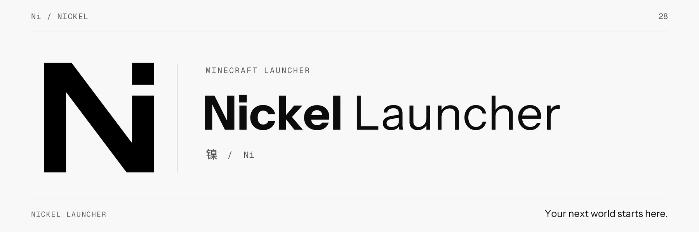

<picture>
  <source media="(prefers-color-scheme: dark)" srcset="src/assets/brand/banners/nickel-launcher-hero-dark.png">
  <source media="(prefers-color-scheme: light)" srcset="src/assets/brand/banners/nickel-launcher-hero-light.png">
  
</picture>

<div align="center">

# Nickel · 镍

**把准备交给 Ni，把时间留给你的世界。**

Minecraft Java 版启动器 · Windows / macOS / Linux

[](https://github.com/Nickel-Studio/Ni-Launcher/releases/tag/v1.0.1)
[](https://github.com/Nickel-Studio/Ni-Launcher/actions/workflows/ci.yml)
[](LICENSE)
[](LICENSE-ASSETS)

[获取 Nickel](https://github.com/Nickel-Studio/Ni-Launcher/releases) · [使用指南](docs/usage.md) · [反馈问题](https://github.com/Nickel-Studio/Ni-Launcher/issues/new/choose) · [参与开发](CONTRIBUTING.md)

</div>

---

## 一枚简标，任意世界

>ps：Nickel Studio正在早期开发阶段，目前仍然正在等待微软批准Ni的Minecraft API访问权限，在此之前正版登录不可用，Curseforge搜索将在微软批准AppID后一并随其上线。

**Nickel**，也叫 **Ni** 或 **镍**。从第一次启动原版，到整理一个装满 Mod 的实例，Ni 把账号、游戏、资源和下载收进同一个安静的界面。

黑与白是它的底色，重点留给正在做的事。

<table>
<tr>
<td width="50%">

### 世界各有位置

多个游戏目录、独立实例、收藏与自定义信息。Java、内存、版本隔离和启动参数可以跟随全局，也可以为一个世界单独设置。

</td>
<td width="50%">

### 从原版到 Mod

安装 Minecraft，选择 Forge、NeoForge、Fabric、OptiFine 或 LiteLoader；在 Modrinth 与 CurseForge 中寻找 Mod、整合包、光影和资源包。

</td>
</tr>
<tr>
<td width="50%">

### 换个身份，继续冒险

微软正版、LittleSkin 等皮肤站和离线账号。保存多个账号，在首页切换；角色头像和皮肤随选择更新。

</td>
<td width="50%">

### 下载不打断操作

统一任务进度、取消与排队。版本、文件和社区资源分别选择下载策略，支持镜像回退、共享线程与限速。

</td>
</tr>
</table>

## 让启动更合你意

- **明暗模式与颜色主题**：跟随系统、亮色或暗色；黑与白，以及五种彩色主题。还可以放一张自己的背景。
- **Mod 管理**：搜索、启用、禁用、检查更新和整理重复条目。
- **整合包分享**：导出标准 `.mrpack`，或带启动器、外观及实例设置的便携 ZIP。
- **启动排障**：查看退出原因，打开游戏日志；按版本选择 Java 和内存管理方式。
- **细节工具**：「更多」里的使用指南、前沿计划、今日人品、内存优化和游戏日志清理。

## 1.0.1 修复

恢复实例与加载器使用的草方块、铁砧、红石等既有功能图标及默认 Mod 图，保留原分配映射；Nickel 品牌 Logo 和应用图标保持不变。

## 开始使用

1. 在 [Releases](https://github.com/Nickel-Studio/Ni-Launcher/releases) 选择对应平台的发行文件。
2. 将 Nickel 放到可写目录，打开后在首页选择账号。
3. 在「资源 → 原版游戏」安装一个版本，或在「选择版本」添加已有游戏目录。
4. 选中实例，回到首页，启动游戏。

| 平台              | 发行格式             | 运行环境                     |
| ----------------- | -------------------- | ---------------------------- |
| Windows x64       | `.exe` / `.msi`      | WebView2                     |
| macOS arm64 / x64 | `.dmg` / `.app`      | 放置完整应用包               |
| Linux x64         | `.AppImage` / `.deb` | WebKitGTK 4.1 及系统图形依赖 |

详细操作、数据位置、Microsoft 登录配置和常见问题见 [使用指南](docs/usage.md)。

<details>
<summary><strong>从源码运行</strong></summary>

准备 Node.js 22+、pnpm 10+、Rust stable 和 [Tauri 系统依赖](https://v2.tauri.app/start/prerequisites/)。

```sh
git clone https://github.com/Nickel-Studio/Ni-Launcher.git
cd Ni-Launcher
pnpm install --frozen-lockfile
pnpm tauri dev
```

构建、测试、发布及可选 API 配置见 [开发文档](docs/development.md)。

</details>

## 一起打磨 Ni

一个清晰的复现、一张交互草图、一处细节修复，都是有价值的贡献。

[提交故障反馈或功能建议](https://github.com/Nickel-Studio/Ni-Launcher/issues/new/choose)，或从 [贡献指南](CONTRIBUTING.md) 开始。

## 开发者

<div align="center">

<a href="https://github.com/ItzArona"></a>
&nbsp;&nbsp;&nbsp;&nbsp;
<a href="https://github.com/ItzPlana"></a>

**[ItzArona](https://github.com/ItzArona) · [ItzPlana](https://github.com/ItzPlana)**

</div>

## 特别鸣谢

**龙腾猫跃**

感谢以下项目与社区带来的灵感、交流和支持：

|                                                                                             | 项目与社区                                               |
| ------------------------------------------------------------------------------------------- | -------------------------------------------------------- |
|                      | [PCL 启动器](https://github.com/Meloong-Git/PCL)         |
|                | [PCL-CE 启动器](https://github.com/PCL-Community/PCL-CE) |
|              | [LinuxDO 社区](https://linux.do)                         |
|  | [ShittimChests](https://github.com/ShittimChests)        |

## 许可与资源

代码采用 **[AGPL-3.0-only](LICENSE)**；Nickel 原创品牌与美术采用 **[CC-BY-SA-4.0](LICENSE-ASSETS)**。作者、资源范围及第三方许可列在 [NOTICE.md](NOTICE.md)。

<div align="center">

**Ni / 28 · Nickel Studio**

</div>
