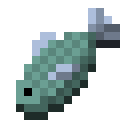

<picture>
  <source media="(prefers-color-scheme: dark)" srcset="src/assets/brand/banners/nickel-launcher-hero-dark.png">
  <source media="(prefers-color-scheme: light)" srcset="src/assets/brand/banners/nickel-launcher-hero-light.png">
  
</picture>

<div align="center">

# Nickel · 镍

**把准备交给 Ni，把时间留给你的世界。**

Minecraft Java 版启动器 · Windows / macOS / Linux

[](https://github.com/Nickel-Studio/Ni-Launcher/releases/tag/v1.0.3)
[](https://github.com/Nickel-Studio/Ni-Launcher/actions/workflows/ci.yml)
[](LICENSE)
[](LICENSE-ASSETS)

[获取 Nickel](https://github.com/Nickel-Studio/Ni-Launcher/releases) · [使用指南](docs/usage.md) · [反馈问题](https://github.com/Nickel-Studio/Ni-Launcher/issues/new/choose) · [参与开发](CONTRIBUTING.md)

</div>

---

## 一枚简标，任意世界

**Nickel**，也叫 **Ni** 或 **镍**。从第一次启动原版，到整理一个装满 Mod 的实例，Ni 把账号、游戏、资源和下载收进同一个安静的界面。

黑与白是它的底色，重点留给正在做的事。

<table>
<tr>
<td width="50%">

### 世界各有位置

多个游戏目录、独立实例、收藏与自定义信息。Java、内存、版本隔离和启动参数可以跟随全局，也可以为一个世界单独设置。

</td>
<td width="50%">

### 从原版到 Mod

安装 Minecraft，选择 Forge、NeoForge、Fabric、OptiFine 或 LiteLoader；在 Modrinth 与 CurseForge 中寻找 Mod、整合包、光影和资源包。

</td>
</tr>
<tr>
<td width="50%">

### 换个身份，继续冒险

微软正版、LittleSkin 等皮肤站和离线账号。保存多个账号，在首页切换；角色头像和皮肤随选择更新。

</td>
<td width="50%">

### 下载不打断操作

统一任务进度、取消与排队。版本、文件和社区资源分别选择下载策略，支持镜像回退、共享线程与限速。

</td>
</tr>
</table>

## 让启动更合你意

- **明暗模式与颜色主题**：跟随系统、亮色或暗色；黑与白、五种彩色主题，以及镍光、铜霞、深海、纸灯、四十二和自定义主题。还可以放一张自己的图片或一段视频作为背景。
- **Mod 管理**：搜索、启用、禁用、检查更新和整理重复条目。
- **整合包分享**：导出标准 `.mrpack`，或带启动器、外观及实例设置的便携 ZIP。
- **启动排障**：查看退出原因，打开游戏日志；按版本选择 Java 和内存管理方式。
- **细节工具**：「更多」里的使用指南、前沿计划和游戏日志清理。

## 1.0.3 更新

- **启动按钮会变身**：准备期间直接在主按钮上取消；进度条、百分比、文件数与速度按阶段浮现，准备阶段不再残留下载数据。
- **多实例启动**：隔离实例可以先后启动，旧实例退出或诊断不会打断新的启动准备。
- **登录与界面打磨**：皮肤站登录改为固定回调的站内授权，登录提示统一为单一路径；社区依赖、下载提示和悬浮提示的交互更加一致。
- **圆角窗口不再漏角**：打开弹窗、出现下载提示或悬浮提示时，透明窗口的四个圆角不再被方形的遮罩、波纹或投影盖住。
- **解压库安全修复**：升级 zip 解压库并修复 3 个安全漏洞，恶意压缩包、JAR 和整合包无法再绕过启动器的路径与大小校验。

## 1.0.2 更新

- **正版登录与 CurseForge 搜索正式可用**：发行版内置已授权的 Microsoft 公共客户端与 CurseForge API 配置，下载即可使用，无需另行配置。
- **新主题与视频背景**：新增镍光、铜霞、深海、纸灯、四十二和自定义主题，主题切换淡入淡出；支持本地 MP4、WebM 等视频背景。
- **更稳的发行物**：四个平台的安装包都经过配置与许可审计，并附带便携版；内嵌配置以加密形式封装。

完整内容见 [更新记录](CHANGELOG.md)。

## 开始使用

1. 在 [Releases](https://github.com/Nickel-Studio/Ni-Launcher/releases) 选择对应平台的发行文件。
2. 将 Nickel 放到可写目录，打开后在首页选择账号。
3. 在「资源 → 原版游戏」安装一个版本，或在「选择版本」添加已有游戏目录。
4. 选中实例，回到首页，启动游戏。

| 平台              | 发行格式                             | 运行环境                     |
| ----------------- | ------------------------------------ | ---------------------------- |
| Windows x64       | `.exe` / `.msi`，便携 `.zip`         | WebView2                     |
| macOS arm64 / x64 | `.dmg`，便携 `.tar.gz`               | 放置完整应用包               |
| Linux x64         | `.AppImage` / `.deb`，便携 `.tar.gz` | WebKitGTK 4.1 及系统图形依赖 |

详细操作、数据位置和常见问题见 [使用指南](docs/usage.md)；从源码构建时的 API 配置见 [开发文档](docs/development.md)。

<details>
<summary><strong>从源码运行</strong></summary>

准备 Node.js 22+、pnpm 10+、Rust stable 和 [Tauri 系统依赖](https://v2.tauri.app/start/prerequisites/)。

```sh
git clone https://github.com/Nickel-Studio/Ni-Launcher.git
cd Ni-Launcher
pnpm install --frozen-lockfile
pnpm tauri dev
```

构建、测试、发布及可选 API 配置见 [开发文档](docs/development.md)。

</details>

## 一起打磨 Ni

一个清晰的复现、一张交互草图、一处细节修复，都是有价值的贡献。

[提交故障反馈或功能建议](https://github.com/Nickel-Studio/Ni-Launcher/issues/new/choose)，或从 [贡献指南](CONTRIBUTING.md) 开始。

## 开发者

<div align="center">

<a href="https://github.com/ItzArona"></a>
&nbsp;&nbsp;&nbsp;&nbsp;
<a href="https://github.com/ItzPlana"></a>

**[ItzArona](https://github.com/ItzArona) · [ItzPlana](https://github.com/ItzPlana)**

</div>

## 特别鸣谢

感谢以下项目与社区带来的灵感、交流和支持：

|                                                                                             | 项目与社区                                               |
| ------------------------------------------------------------------------------------------- | -------------------------------------------------------- |
|                      | [PCL 启动器](https://github.com/Meloong-Git/PCL)         |
|                | [PCL-CE 启动器](https://github.com/PCL-Community/PCL-CE) |
|  | [ShittimChests](https://github.com/ShittimChests)        |

## 许可与资源

代码采用 **[AGPL-3.0-only](LICENSE)**；Nickel 原创品牌与美术采用 **[CC-BY-SA-4.0](LICENSE-ASSETS)**。作者、资源范围及第三方许可列在 [NOTICE.md](NOTICE.md)。

<div align="center">

**Ni / 28 · Nickel Studio**

</div>
